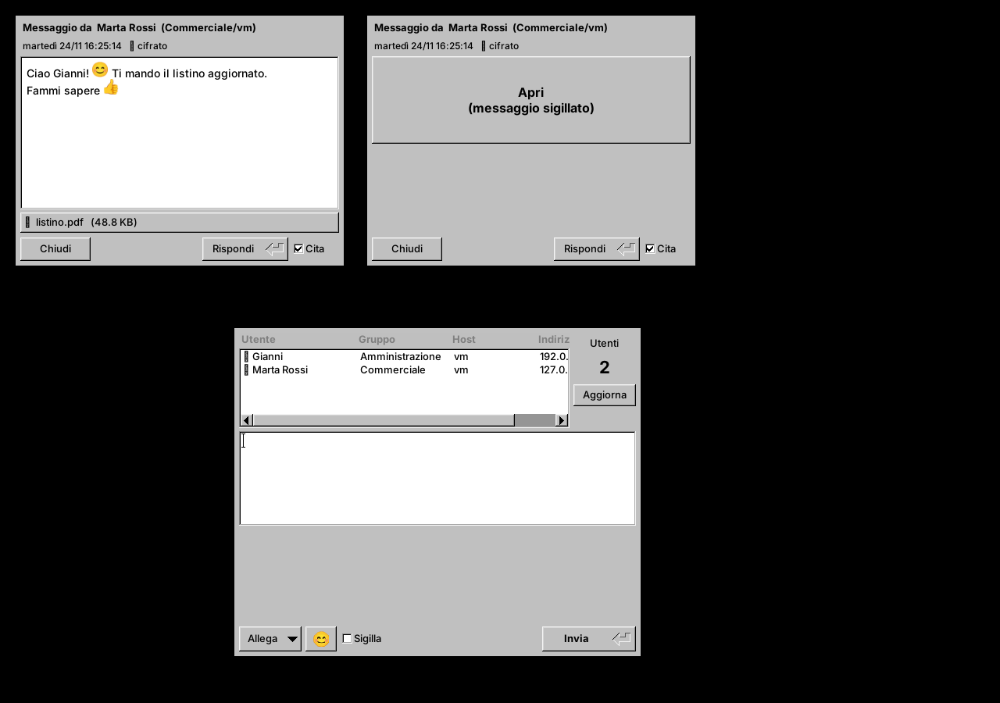
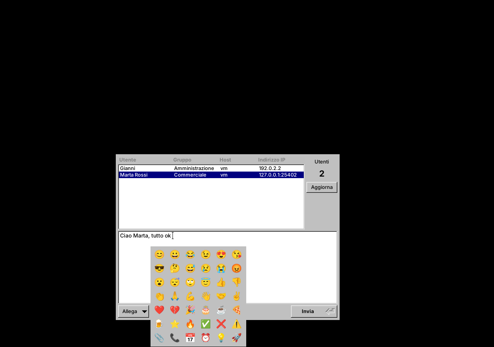
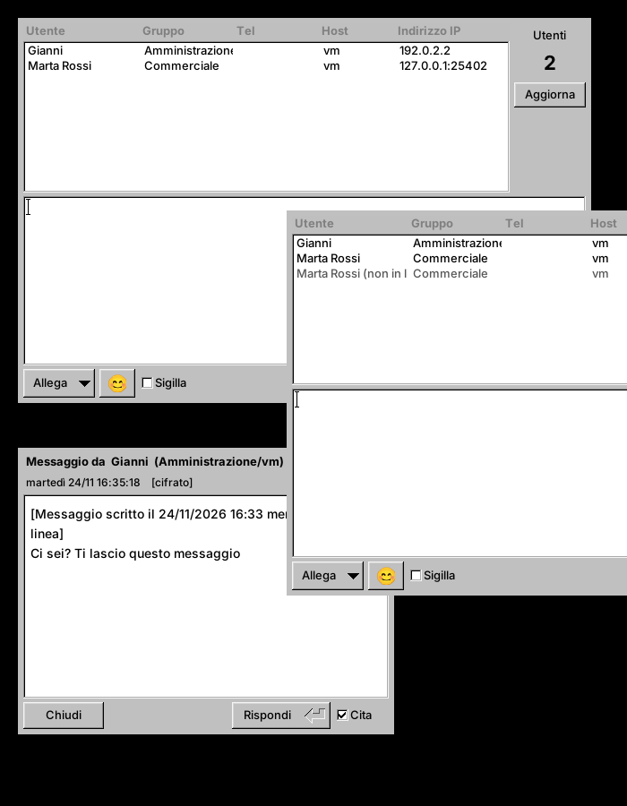
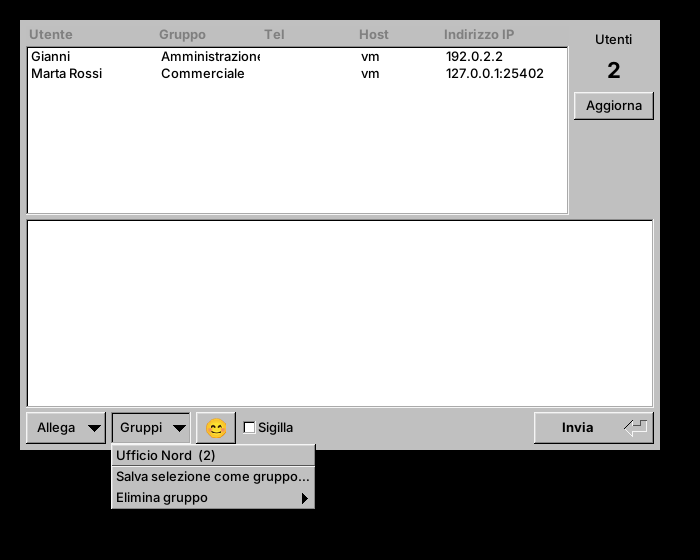

# POPMSG

Messaggistica istantanea per la rete locale, **senza server**, nello stile di IP Messenger.
Parla il protocollo di IP Messenger (UDP/TCP porta 2425), quindi vede e scambia messaggi
anche con i client IP Messenger originali presenti in rete.

Scritto in **Rust** con la libreria grafica **FLTK**: un solo eseguibile di circa 3,5 MB,
nessuna installazione, circa **3 MB di memoria privata** (11-12 MB di RSS su Linux,
librerie di sistema comprese). Funziona su **Windows**, **macOS** e **Linux**.

| Messaggi ricevuti | Emoticon | Utenti non in linea | Gruppi |
|---|---|---|---|
|  |  |  |  |

## Funzioni

- Scoperta automatica degli utenti in rete (broadcast UDP), mostrati in una **tabella a griglia**
  con le colonne Utente, Gruppo, Tel, Host e Indirizzo IP: le colonne si allargano e restringono
  trascinando il bordo dell'intestazione, si nascondono o mostrano col tasto destro
  sull'intestazione, e un clic sull'intestazione ordina (un secondo clic inverte l'ordine).
  La disposizione resta salvata
- **Utenti non in linea** in grigio: si può scrivere anche a loro, il messaggio resta in attesa
  sul proprio computer e viene consegnato appena il destinatario apre POPMSG
  (opzione attivabile in *Impostazioni*, attiva di base)
- **Elenco utenti condiviso**: quando due POPMSG si incontrano si scambiano da soli l'elenco
  degli utenti conosciuti (senza i numeri di Tel), così ognuno vede in grigio anche chi non ha
  mai incontrato direttamente (opzione in *Impostazioni*, attiva di base)
- Non serve aspettare che tutti aprano POPMSG almeno una volta: col tasto destro sulla lista
  - *Aggiungi utente…*: nome, gruppo e nome del computer o indirizzo IP; quando quella persona
    aprirà POPMSG verrà riconosciuta e riceverà i messaggi in attesa
  - *Esporta elenco utenti…* / *Importa elenco utenti…*: chi ha già l'elenco completo lo salva
    in un file, con o senza i numeri di Tel, e gli altri lo importano (i numeri di Tel già
    scritti su quel computer non vengono cambiati)
- **Gruppi di destinatari** personali: seleziona gli utenti, *Gruppi → Salva selezione come gruppo…*,
  poi con un clic sul nome del gruppo li selezioni tutti e invii lo stesso messaggio a ciascuno
  (salvati solo sul proprio computer)
- Colonna **Tel**: ognuno annota i numeri degli altri (tasto destro → *Modifica Tel…*),
  salvati solo sul proprio computer
- **Emoticon** a colori: tutto il set standard (circa 1900, divise in categorie come su
  WhatsApp) dal pulsante 😊, più una **riga di preferite** sopra i pulsanti con quelle che usi
  di più. Sono disegnate come immagini: uguali su tutti i sistemi
- **Cifratura** RSA 2048 + AES 256 compatibile con IP Messenger, automatica quando anche
  l'altro la supporta; altrimenti il messaggio passa in chiaro
- **Firma digitale** (RSA + SHA-256) su ogni messaggio cifrato: chi riceve vede
  *firma verificata* oppure *FIRMA NON VALIDA*
- **Formato v5** di IP Messenger (pacchetti IPDict cifrati con AES-256-CTR e firmati), usato con
  chi lo supporta; opzione *sperimentale* in *Impostazioni*, spenta di base
- **Messaggi sigillati** di base, con avviso di apertura al mittente. Con il **lucchetto** il
  destinatario deve inserire la propria password per aprirli (la password si imposta in
  *Impostazioni*; c'è anche l'opzione per chiederla per tutti i sigillati)
- **Immagini incollate** dagli appunti con Ctrl+V nel testo: partono come immagini di
  IP Messenger e chi riceve le vede come miniature dentro il messaggio (clic per aprirle)
- **Rispondi** con citazione, invio con **Ctrl+Invio**, conferma di consegna e nuovi tentativi
- **Stato** Disponibile / Assente / Occupato con messaggio di risposta automatica personalizzato
  (tasto destro sulla lista → *Stato…*, oppure dall'icona nella barra di sistema); gli altri
  vedono "(assente)" o "(occupato)" accanto al nome
- **Chat di gruppo**: seleziona gli utenti e premi *Chat*; ognuno vede i messaggi di tutti nella
  stessa finestra. Con chi usa IP Messenger il messaggio arriva come messaggio normale col titolo
  della chat
- **Invio di file e cartelle** via TCP: trascinali in qualunque punto della finestra di invio
  (lista, testo o pulsanti) oppure usa *Allega*
- Icona nella barra di sistema, avvio automatico con Windows
- **Registro dei messaggi** con ricerca (tutte le parole, maiuscole o minuscole indifferenti)
- Indirizzi broadcast aggiuntivi per raggiungere altre sottoreti

## Scaricare

Gli eseguibili si trovano negli *Artifacts* dell'ultima esecuzione di **Actions → Build**
(o nelle *Releases*, se create con un tag `v*`):

- `POPMSG-windows.zip` → `POPMSG.exe`
- `POPMSG-macos.zip` → `POPMSG.app` (al primo avvio: tasto destro → Apri)
- `POPMSG-linux.tar.gz` → `POPMSG`

Al primo avvio Windows può chiedere di consentire l'accesso alla rete: consenti le reti private.

### Installatore per Windows

`POPMSG-setup.exe` (artifact `POPMSG-windows-setup`, o nelle *Releases*) fa tutto in un passo:
installa POPMSG in *Programmi*, rende attendibile il certificato della firma (se la compilazione
è firmata), crea il collegamento nel menu Start, l'avvio automatico all'accesso e la regola del
firewall, e si disinstalla da *App installate*. Per installarlo su molti PC senza domande:
`POPMSG-setup.exe /VERYSILENT /SUPPRESSMSGBOXES`.

### Aggiornamenti

POPMSG controlla da solo (un minuto dopo l'avvio e poi ogni 6 ore) se c'è una versione più nuova
e propone di installarla; si può anche usare *Cerca aggiornamenti…* dal tasto destro o
dall'icona. Le nuove versioni arrivano:

- dalle *Releases* di GitHub (serve Internet): la release si crea su GitHub con un tag `vX.Y.Z`
  uguale alla versione in `Cargo.toml`, e la compilazione ci allega i file;
- oppure da una **cartella di rete** indicata in *Impostazioni → Aggiornamenti da*
  (es. `\\server\popmsg`) in cui si copiano `POPMSG.exe` e `POPMSG-setup.exe` della nuova versione.

Se POPMSG è firmato, accetta solo aggiornamenti firmati con lo stesso certificato. Installato in
*Programmi*, l'aggiornamento passa dall'installatore e chiede la conferma di amministratore.

Il numero di versione è nel titolo della finestra e in cima al menu del tasto destro.

## Firma degli eseguibili

La compilazione firma gli eseguibili quando nei *Secrets* del repository
(*Settings → Secrets and variables → Actions*) ci sono i certificati:

- **Windows**: `WINDOWS_CERT_PFX` (il certificato di firma del codice `.pfx` codificato in base64)
  e `WINDOWS_CERT_PASSWORD`. Senza, l'eseguibile non è firmato. Per un certificato
  autofirmato (uso in ufficio) c'è `docs/firma/crea-certificato.ps1`: crea il certificato e il
  testo da incollare nel Secret. Lo zip per Windows contiene allora anche la cartella
  `certificato` con il certificato pubblico, `installa-certificato.cmd` (da avviare come
  amministratore su ogni PC) e le istruzioni per distribuirlo con un criterio di gruppo.
- **macOS**: `MACOS_CERT_P12` (certificato *Developer ID Application* in base64) e
  `MACOS_CERT_PASSWORD`; per la notarizzazione anche `APPLE_ID`, `APPLE_TEAM_ID` e
  `APPLE_APP_PASSWORD`. Senza, l'app ha una firma *ad hoc*.

## Dove salva i dati

Nella cartella `%APPDATA%\POPMSG` (Windows), `~/Library/Application Support/POPMSG` (macOS)
o `~/.config/popmsg` (Linux): impostazioni (`popmsg.ini`), chiave RSA personale (`key.pem`),
rubrica dei numeri (`rubrica.ini`), gruppi (`gruppi.txt`), utenti conosciuti (`utenti.txt`), messaggi in attesa
(`in_attesa.txt`), immagini incollate inviate (`appunti`) e ricevute (`immagini`) e registro (`popmsg.log`).

## Compilare

```bash
cargo build --release       # eseguibile in target/release/
cargo test --release        # protocollo, cifratura, formato v5 e prove complete tra istanze
```

Su Linux servono i pacchetti di sviluppo di X11, Xft, fontconfig e dbus
(vedi `.github/workflows/build.yml`).

## Note

- Le emoticon sono immagini tratte da Noto Emoji (licenza Apache 2.0).
- Chi chiude POPMSG normalmente esce subito dalla lista degli altri; se il computer si spegne
  di colpo, resta in lista finché qualcuno preme **Aggiorna**.
