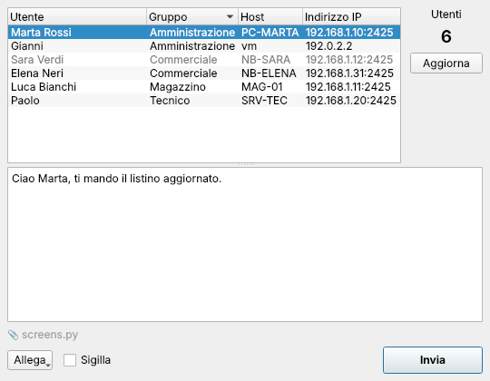

# POPMSG

Messaggistica istantanea per la rete locale, **senza server**, nello stile di IP Messenger.
Parla il protocollo di IP Messenger (UDP/TCP porta 2425), quindi vede e scambia messaggi
anche con i client IP Messenger originali presenti in rete.

Funziona su **Windows**, **macOS** e **Linux**.

| Invia messaggio | Messaggio ricevuto | Messaggio sigillato |
|---|---|---|
|  |  |  |

## Funzioni

- Scoperta automatica degli utenti in rete (broadcast UDP), con nome, gruppo, host e IP
- Elenco utenti ordinabile, selezione multipla e per gruppo, pulsante **Aggiorna** (F5)
- Invio con **Ctrl+Invio**, conferma di consegna e nuovo tentativo automatico
- **Messaggi sigillati**: il destinatario deve premere *Apri* e tu ricevi l'avviso di lettura
- **Rispondi** con citazione del messaggio originale
- **Modalità assenza** con risposta automatica (preimpostate o personalizzata)
- **Invio di file e cartelle** via TCP: trascina nella finestra o usa *Allega*
- Icona nella barra di sistema, avviso con icona se la finestra non si apre da sola
- Registro dei messaggi su file, con ricerca
- Indirizzi broadcast aggiuntivi per raggiungere altre sottoreti
- Avvio automatico con Windows (opzionale)

Non ancora supportata: la cifratura RSA/AES delle versioni recenti di IP Messenger
(i messaggi con i client originali passano in chiaro, come con la cifratura disattivata).

## Scaricare

Le versioni pronte si trovano nelle *Releases* del repository oppure negli *Artifacts*
dell'ultima esecuzione di **Actions → Build**:

- `POPMSG-windows.zip` → `POPMSG.exe`, un solo file, non serve installare nulla
- `POPMSG-macos.zip` → `POPMSG.app` (al primo avvio: tasto destro → Apri)
- `POPMSG-linux.tar.gz` → eseguibile `POPMSG`

Al primo avvio Windows può chiedere di consentire l'accesso alla rete: consenti almeno le reti private.

## Eseguire dai sorgenti

```bash
python -m pip install -r requirements.txt
python run.py
```

Opzione `--show` per aprire subito la finestra di invio.

## Creare l'eseguibile

```bash
python -m pip install -r requirements-build.txt
python build.py        # risultato in dist/
```

Per pubblicare una release basta creare un tag `v1.0.0` e fare push: GitHub Actions
crea gli eseguibili per i tre sistemi e li allega alla release.

## Test

```bash
QT_QPA_PLATFORM=offscreen python tests/test_engine.py
```

Il test avvia due istanze sulla stessa macchina e verifica scoperta, messaggi sigillati con
conferma di lettura, assenza, invio di file e cartelle e uscita.

## Struttura

- `popmsg/protocol.py`: costanti e formato dei pacchetti IP Messenger
- `popmsg/engine.py`: rete (UDP presenza e messaggi, server TCP per i file, download)
- `popmsg/ui/`: finestre (invio, ricezione, impostazioni, registro) e icone
- `popmsg/app.py`: icona nella barra di sistema e coordinamento delle finestre
